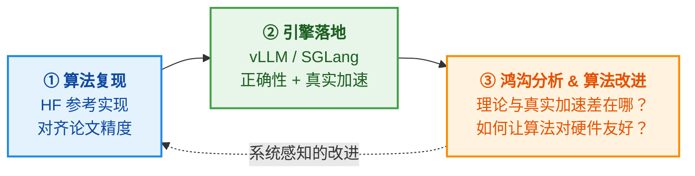

# From Paper to Engine：算法落地推理引擎项目集

面向**本科生与低年级研究生**的入组项目集。主题是**把论文中的高效推理算法真正落地到工业级推理引擎（vLLM / SGLang）中，并拿到真实的加速收益**。

> 最后更新：2026-10 ｜ 适用对象：刚进组、有 Python/PyTorch 和深度学习基础的同学

---

## 项目定位：算法为主，Infra 为辅

我们组以算法研究为主。但高效推理方向的算法有一个普遍的问题：

> 论文里报告"FLOPs 减少 70%"或"加速 3×"，往往是在 HuggingFace 上、batch size = 1、不开 CUDA Graph、不和 continuous batching 共存的条件下测出来的。放进 vLLM / SGLang 这样的真实推理引擎后，加速常常缩水甚至变成负数。

几个典型例子：

- **投机解码**：论文报告 3× 加速。但 MLSys 2026 的 *Speculative Decoding: Performance or Illusion?* 在 vLLM 上系统测量后发现，真实加速离理论上界很远，batch 增大后还会迅速消失，有生产测量显示 batch 从 2 增到 48 时 EAGLE 的加速从 1.3× 降到 0.7×。
- **扩散语言模型（dLLM）**：Fast-dLLM 等方法在 batch=1 时有可观的加速。但 dLLM 的优势来自"用并行解码填满空闲算力"，batch 一大，GPU 本来就忙，优势就会缩小。要和成熟的 AR 引擎公平比较，dLLM 还需要 KV Cache、CUDA Graph、批处理调度等一整套系统支持。
- **KV Cache 压缩 / Token 剪枝 / 稀疏注意力**：理论上省了计算或显存，但 token 级的不规则稀疏和 FlashAttention、Paged KV、Prefix Caching 天然冲突。不改造 kernel 和内存管理，就拿不到真实收益。
- **量化**：W4A4 理论上快 4×，但在线旋转、反量化的开销以及 kernel 支持决定了真实加速。QServe 等工作说明，算法设计必须和 kernel 协同。

**因此，本项目集的每个选题都遵循同一条主线：**

第 ③ 步是我们最看重的研究训练：**从系统约束出发反过来改进算法**。很多好的研究 idea 就是从这里来的。例如 EAGLE-2 动态草稿树、Native Sparse Attention 的"硬件对齐"设计、QServe 的 W4A8KV4 协同设计、块扩散（Block Diffusion）对 KV Cache 的兼容，都是这类思路的产物。

我们**不要求**同学成为 Infra 工程师。但要求能回答这几个问题：**你的算法在真实引擎里为什么快、为什么不快、什么时候快？**

---

## Agent-first

**鼓励**使用 Claude Code、Codex、Cursor 等 AI Agent 完成编码，特别是在 vLLM / SGLang 这类大型代码库中做适配。没有必要纯手写。我们考察的是：

- 能否**指挥 Agent** 在陌生的大型代码库中做出正确的改动；
- 能否**判断** Agent 写的东西对不对、快不快、测得是否可信；
- 能否在汇报中**讲清楚**算法原理、系统机制，以及每一个数字的来历。

> **代码可以是 Agent 写的，但理解必须是你自己的。** 详见 [docs/guidelines.md](docs/guidelines.md)。

---

## 项目一览

难度：★★★ 中等 ｜ ★★★★ 较难 ｜ ★★★★★ 挑战。"算法 : 系统"是该项目工作量的大致比例。

### 热身（所有人必做，2–3 周）

| 编号 | 项目 | 说明 |
|---|---|---|
| [P00](projects/P00-warmup/README.md) | 推理引擎速成：从 Roofline 到 vLLM 插件 | 跑通 benchmark 和 profiling，写一个最小插件，完成一份"理论 vs 实测"分析 |

### 解码加速

| 编号 | 项目 | 难度 | 算法 : 系统 | 最低硬件 |
|---|---|---|---|---|
| [P01](projects/P01-speculative-decoding-to-engine/README.md) | 投机解码新方法的引擎落地 | ★★★★ | 5 : 5 | 1×80GB |
| [P02](projects/P02-batch-aware-speculation/README.md) | 大 Batch 下的投机解码：让加速真实存在 | ★★★★ | 6 : 4 | 1×80GB |
| [P03](projects/P03-dllm-parallel-decoding/README.md) | 扩散语言模型：并行解码策略的引擎落地 | ★★★★ | 5 : 5 | 1×80GB |
| [P04](projects/P04-ar-to-block-diffusion/README.md) | 自回归 → 块扩散：模型转换、训练与部署 | ★★★★★ | 7 : 3 | 4–8×80GB |

### KV Cache 与注意力

| 编号 | 项目 | 难度 | 算法 : 系统 | 最低硬件 |
|---|---|---|---|---|
| [P05](projects/P05-reasoning-kv-compression/README.md) | 推理模型的解码期 KV Cache 压缩 | ★★★★ | 5 : 5 | 1×24GB |
| [P06](projects/P06-sparse-prefill-attention/README.md) | 长上下文稀疏注意力的引擎落地 | ★★★★ | 5 : 5 | 1×80GB |
| [P07](projects/P07-vlm-token-compression/README.md) | 多模态大模型视觉 Token 压缩的服务化 | ★★★★ | 6 : 4 | 1×24GB |

### 模型压缩与架构

| 编号 | 项目 | 难度 | 算法 : 系统 | 最低硬件 |
|---|---|---|---|---|
| [P08](projects/P08-low-bit-quantization/README.md) | 低比特量化算法的部署：从精度到真实加速 | ★★★★ | 6 : 4 | 1×24GB（FP8/FP4 需 Ada/Hopper/Blackwell） |
| [P09](projects/P09-moe-adaptive-experts/README.md) | MoE 自适应专家计算的引擎落地 | ★★★★ | 6 : 4 | 1×80GB |
| [P10](projects/P10-hybrid-linear-attention-distill/README.md) | Transformer → 混合线性注意力：蒸馏与部署 | ★★★★★ | 7 : 3 | 2–8×80GB |

### 测试时计算与训推

| 编号 | 项目 | 难度 | 算法 : 系统 | 最低硬件 |
|---|---|---|---|---|
| [P11](projects/P11-efficient-reasoning-serving/README.md) | 高效推理：思考早停与置信度剪枝的服务化 | ★★★ | 6 : 4 | 1×24GB |
| [P12](projects/P12-rl-train-inference-mismatch/README.md) | RL 训推不一致：算法校正 vs 系统对齐 | ★★★★ | 6 : 4 | 2×80GB |

> 硬件说明：24GB 指 RTX 3090/4090/A10 一档，80GB 指 A100/H100/H800 一档。详见 [docs/environment.md](docs/environment.md)。

### 选题建议

- **本科生 / 第一个项目**：P11、P05、P07。机制相对直观，单卡可完成。
- **研一，偏算法**：P02、P08、P09。核心是设计算法策略，系统改动相对局部。
- **研一，愿意深入系统**：P01、P03、P06。需要较多地改动引擎内部。
- **有训练资源、目标做研究**：P04、P10、P12。训练量大，贴近当前研究前沿，容易产出论文 idea。

项目之间可以组队、共享基础设施。例如 P01 / P02 共享投机解码的评测框架，P03 / P04 共享 dLLM 推理代码，P05 / P06 共享注意力 kernel 的经验。

每个项目建议 **1–2 人**，周期 **10–12 周**（含热身）。允许自拟选题，只要符合"算法 → 引擎落地 → 真实收益"的主线，按 [templates/proposal.md](templates/proposal.md) 写开题。

---

## 流程与里程碑

| 阶段 | 时间（建议） | 产出 |
|---|---|---|
| **W0 热身** | 第 1–2 周 | 完成 [P00](projects/P00-warmup/README.md) |
| **M0 开题** | 第 3 周 | 开题报告（[模板](templates/proposal.md)）：讲清算法、预期的落地难点、实验计划 |
| **M1 算法复现** | 第 4–5 周 | HF 参考实现，精度对齐论文；同时测出"论文式"加速（作为对照） |
| **M2 中期检查** | 第 7 周 | 引擎内实现跑通，有正确性测试和初步的真实加速数据 |
| **M3 结题答辩** | 第 11–12 周 | 完整实现、鸿沟分析、（可选）系统感知的算法改进、报告和 Live Demo |

整个过程中维护开发日志（[模板](templates/devlog.md)）。

---

## 文档索引

- [docs/guidelines.md](docs/guidelines.md)：**AI Agent 使用规范**与红线（必读）
- [docs/core-knowledge.md](docs/core-knowledge.md)：所有人都要掌握的**推理系统核心知识**，重点是"理论加速 vs 真实加速"
- [docs/benchmarking.md](docs/benchmarking.md)：**质量 + 效率双重评测规范**，以及如何报告"真实加速"
- [docs/engine-extension-guide.md](docs/engine-extension-guide.md)：在 vLLM / SGLang 中接入算法的常见途径（插件、logits processor、spec decode、attention backend、量化方法、dLLM 算法接口……）
- [docs/evaluation.md](docs/evaluation.md)：考核标准与答辩形式
- [docs/environment.md](docs/environment.md)：硬件 / 软件 / 模型 / 数据集建议
- [docs/reading-list.md](docs/reading-list.md)：分主题阅读清单
- [templates/](templates/)：开题报告、开发日志、结题报告模板

---

## 维护说明

vLLM / SGLang 迭代极快。例如 vLLM 近期版本已默认切换到 Model Runner V2，logits processor 等插件接口在新旧 runner 之间并不相同。因此：

- **每个项目开题时必须锁定上游版本（commit hash）**，项目周期内不随意升级；
- 本仓库中出现的类名、参数名、文件路径仅供参考，**以锁定版本的源码为准**；
- 发现内容过时，欢迎直接提 PR 更新。
