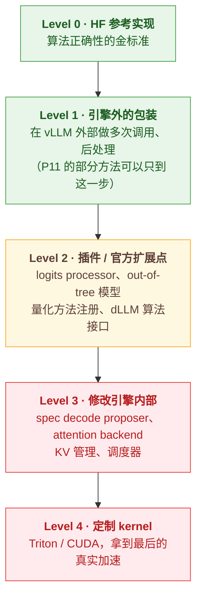

# 在推理引擎中接入算法：常见途径

把一个算法放进 vLLM / SGLang，第一步是找到**合适的接入点**。接入点选对了，改动可以很小、很干净；选错了，就会陷入在调度器、内存管理、kernel 之间到处打补丁的局面。

本文列出常见的接入途径，供开题时参考。

> ⚠️ 两个框架的内部 API 变化很快。例如 vLLM 近期版本已默认使用 Model Runner V2，logits processor 等接口与旧版 V1 runner 不同。下面提到的类名、参数和路径**仅作为线索**，务必以你锁定版本的源码和文档为准。可以先让 Agent 在锁定版本的代码中定位这些接口，再自己逐一确认。

---

## 1. 接入点总览

| 算法类型 | vLLM 接入点 | SGLang 接入点 | 相关项目 |
|---|---|---|---|
| 采样 / 解码控制（早停、预算控制、置信度监控） | 自定义 Logits Processor；`SamplingParams.extra_args` 传递每请求参数 | Custom Logit Processor（需启动参数开启）；前端语言（`fork` / `select` 等） | P11 |
| 投机解码（新的草稿方法、验证策略） | `--speculative-config`；`vllm/v1/spec_decode/` 下的 proposer；rejection sampler；草稿模型训练用 Speculators | `--speculative-algorithm`；`srt/speculative/` 目录；草稿模型训练用 SpecForge | P01、P02 |
| 扩散语言模型（dLLM） | Model Runner V2 的 `ModelState` 钩子（参考 DiffusionGemma 的实现） | dLLM 算法接口：`--dllm-algorithm` + `--dllm-algorithm-config`，可以注册自定义算法 | P03、P04 |
| 注意力变体（稀疏、压缩） | Attention backend（如 `FLASH_ATTN`、`FLASHINFER`、`TRITON_ATTN`，位置以版本为准）；KV cache spec / layout | `srt/layers/attention/` 下的各 backend | P05、P06 |
| KV Cache 管理（淘汰、压缩） | KV Cache Manager / Block Pool；KV cache spec | `RadixCache`、memory pool | P05 |
| 多模态 token 处理 | 模型文件（如 `qwen2_5_vl.py` / `qwen3_vl.py`）与 multimodal processor；placeholder token 数在调度前确定 | 模型文件与 multimodal processor | P07 |
| 量化 | `vllm/model_executor/layers/quantization/`；`@register_quantization_config` 注册自定义方法；compressed-tensors 格式（LLM Compressor 生成） | `srt/layers/quantization/` | P08 |
| MoE 计算 | `fused_moe` 层与 router；Triton / CUTLASS / DeepGEMM 后端 | `srt/layers/moe/` | P09 |
| 新模型架构 | Out-of-tree 模型注册：`ModelRegistry.register_model(...)` + `vllm.general_plugins` entry point；也可以先用 Transformers 后端（`--model-impl transformers`）快速验证 | `srt/models/` 下新增模型；外部模型注册机制 | P04、P10 |
| 训推权重同步 / RL | Native RL APIs（`init_weight_transfer_engine` / `update_weights` 等）；batch invariance 模式（`VLLM_BATCH_INVARIANT=1`） | 权重更新接口；确定性推理模式 | P12 |

## 2. 推荐的落地路径：从侵入性最低的方案开始



> 从上到下，侵入性和工程量递增，能拿到的真实加速潜力也递增。

- **能用低 Level 解决的，不要用高 Level**。但也要意识到，很多算法**只有到 Level 3–4 才能拿到真实加速**；
- 每上一个 Level，都要和上一 Level 做**正确性对比**（输出一致或精度一致）。

## 3. 常见的"系统约束"清单

开题时，逐条检查你的算法和下面这些约束是否冲突。冲突本身不可怕，它往往正是研究点所在：

| 约束 | 典型冲突 |
|---|---|
| **FlashAttention 不输出注意力矩阵** | 依赖注意力分数的剪枝 / 淘汰 / 稀疏方法 |
| **Paged KV 以 block 为单位管理** | token 级淘汰；每层保留不同 token 数；中途修改 KV |
| **Prefix Caching 假设相同前缀 → 相同 KV** | 依赖后续 query 的剪枝；对 KV 做请求相关的修改 |
| **Continuous Batching 要求不同请求混合执行** | 每请求不同的计算路径（动态层数、动态专家数、动态投机长度） |
| **CUDA Graph 要求静态 shape 和静态控制流** | 动态 shape；数据相关的控制流；每步不同的 token 数 |
| **调度器需要提前知道 token 数** | 多模态 token 剪枝（placeholder 数在调度前确定）；dLLM 的不定步数 |
| **Kernel 对规整 shape 才高效** | 不规则稀疏；非 2 的幂次；小 GEMM |
| **Tensor Parallel 下的数据切分** | 需要全局信息的打分（跨 head / 跨 rank 的统计） |

## 4. 给 Agent 的提示词模板

在大型代码库中定位接入点时，可以参考：

```
我在 vLLM <commit hash> 上实现 <算法名>。算法需要 <在每个 decode step 读取 X / 修改 Y>。
请：
1. 在源码中找到可能的接入点，列出文件路径、类名、函数名和行号；
2. 对每个候选接入点，说明它与 CUDA Graph、continuous batching、prefix caching 的交互；
3. 推荐侵入性最低的方案并说明理由；
4. 先不要写代码。
```

拿到回答后，**自己打开每个文件逐一确认**。Agent 对快速迭代项目的描述经常和真实代码有出入。
